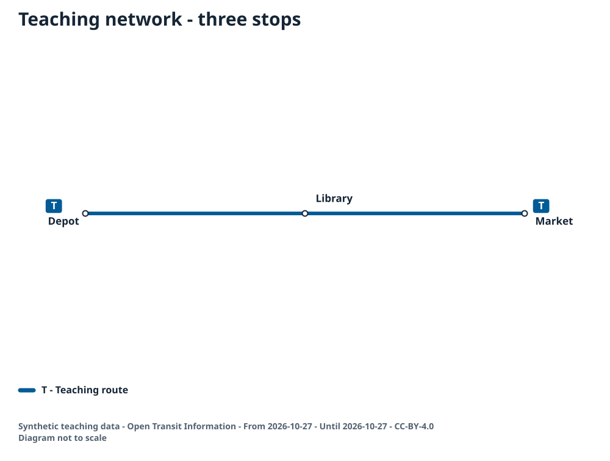
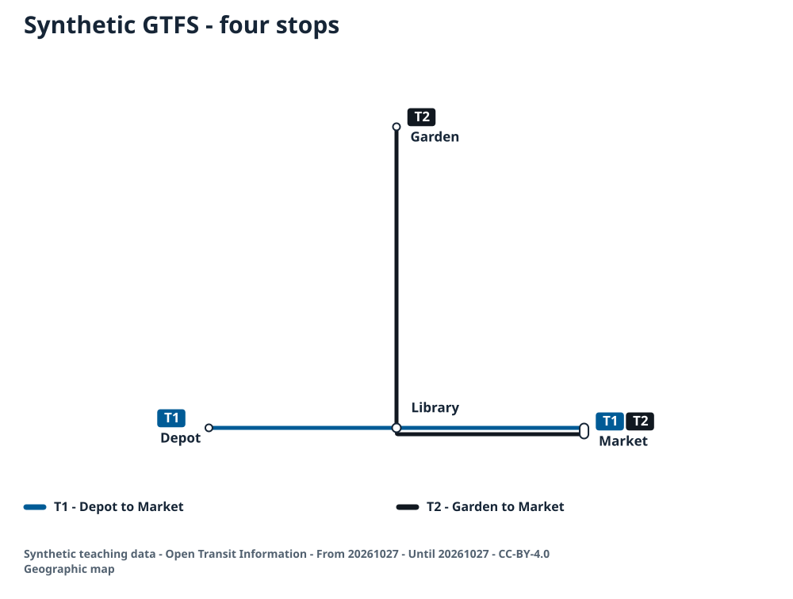

<!-- SPDX-License-Identifier: CC-BY-4.0 -->
# Make your first transit map

This guide uses the published **opentransitinformation 0.4.0** to make a small SVG, import a synthetic GTFS feed and mount an interactive map in a web page. The teaching records describe no operator or passenger service. You can complete these examples without a transport API account, a real feed or Rust.

## Requirements

Use Node.js 24 LTS and its npm command, plus a browser with JavaScript, WebAssembly and Web Workers. Check `node --version` and `npm --version` before starting. Node 24 is a supported LTS line on the [Node.js release schedule](https://nodejs.org/en/about/previous-releases); the published package's Node >=20 compatibility floor is not a recommendation to use an unsupported runtime.

The commands below run from `examples/first-use`, not the repository root. They work in PowerShell and ordinary POSIX shells. On Windows, if PowerShell blocks `npm.ps1`, use `npm.cmd` for the same commands; changing the execution policy is unnecessary.

## Install

Choose one starting route. Git is needed only for the repository route.

With Git, clone the public technical repository and enter the example directory:

```sh
git clone --branch main https://github.com/uningeniero/opentransitinformation.git
cd opentransitinformation/examples/first-use
```

With the example kit, extract the ZIP into a new folder. Open a terminal in that extracted folder, which contains `docs/`, `examples/` and `example-kit-manifest.json`, then enter:

```sh
cd examples/first-use
```

From either route's `examples/first-use` directory, install and confirm the package:

```sh
npm ci --ignore-scripts
npm ls opentransitinformation --depth=0
```

The final command must show `opentransitinformation@0.4.0`. `package.json` and `package-lock.json` pin the dependency. Installation is local to this example directory; no global package or source build is required. The examples were added after the 0.4.0 release, so obtain their source from this guide's source revision or the example kit, rather than the older `v0.4.0` source archive.

The only direct dependencies are `opentransitinformation@0.4.0` and `fflate@0.8.2`, used to create the teaching ZIP. Initial dependency installation needs npm registry access. Map generation and the prepared web page then use local data and package assets.

## 01 - Tiny network

Start with [01-tiny/network.json](../examples/first-use/01-tiny/network.json). It contains three planar stop positions, route `T` and one ordered stop sequence: Depot, Library, Market. Planar positions are drawing inputs, not longitude and latitude.

```sh
npm run tiny
```

`01-tiny/build.mjs` reads that file and calls the public API:

```js
import { createDiagram } from 'opentransitinformation';
import { toHtml } from 'opentransitinformation/node';

const options = { generatedAt: '2026-10-27T00:00:00Z', width: 1000, height: 640 };
const diagram = await createDiagram(network, options);
const html = await toHtml(network, options);
```

The executable script writes `out/01-tiny/map.svg`, `map.html`, `qa.json` and `result.json`. Open the SVG to see route `T` connecting the three named stops. The self-contained `map.html` embeds its module, WASM and font data: it can be opened directly as a file, unlike the fetched-module example below.

Expected result: one route, one path, three stops, three rendered labels and `qaPassed: true`. The generation timestamp is deliberately fixed so the generated SVG digest can be compared with [expected/result.json](../examples/first-use/01-tiny/expected/result.json).



The program rejects coordinates with the wrong shape or non-finite values. Keep two finite numbers in every `position`, retain unique stop/route IDs and use existing stop IDs in `stopIds`. Read the error code and the QA report before changing layout options.

You can also exercise the CLI shipped with this exact local dependency:

```sh
node node_modules/opentransitinformation/dist/cli.mjs 01-tiny/network.json --out out/01-tiny/cli.svg --qa out/01-tiny/cli-qa.json
```

Its QA output should report one route and three stops. The CLI uses its default size and generation time, so compare its QA counts rather than the API example's fixed SVG digest.

## 02 - Synthetic GTFS

The files in [02-gtfs/feed](../examples/first-use/02-gtfs/feed) form a small, synthetic teaching feed. Its single service date is **27 October 2026**, passed to the importer as `20261027`. Always use that fixed date for this example; today's date may select no service.

```sh
npm run gtfs
```

The script creates `out/02-gtfs/feed.zip`, then passes its bytes to `fromGtfs`. A filesystem path string is not GTFS data:

```js
import { readFile } from 'node:fs/promises';
import { fromGtfs, createDiagram } from 'opentransitinformation';

const bytes = new Uint8Array(await readFile('out/02-gtfs/feed.zip'));
const network = fromGtfs(bytes, {
  id: 'oti-teaching-gtfs',
  name: 'Synthetic GTFS - four stops',
  date: '20261027',
  metadata: { source: 'Synthetic teaching data - Open Transit Information', license: 'CC-BY-4.0' }
});
const diagram = await createDiagram(network, {
  generatedAt: '2026-10-27T00:00:00Z', width: 1000, height: 640
});
```

The feed has one teaching agency, four stops, two routes, two trips, six stop-time rows, six shape-point rows and one calendar row. Each trip has stop sequences 1, 2 and 3. `TRIP_A` links route `TA`, service `ONE_DAY` and shape `SHAPE_A`; `TRIP_B` links `TB`, the same service and `SHAPE_B`. Route `T1` follows Depot - Library - Market; route `T2` follows Garden - Library - Market. Shapes follow those same ordered coordinates. Wheelchair values are `0`, meaning no accessibility information is supplied.

The ZIP has eight GTFS tables and its data licence at archive root. `feed.mjs` inserts files in a fixed order, stores entries without compression and fixes ZIP calendar fields to 1 January 2000. That ZIP header timestamp is unrelated to the service date. The SVG's generation timestamp is also fixed explicitly. Neither field asks the package to retrieve historical upstream data.

Expected result: two routes, two paths, four stops, four rendered labels and `qaPassed: true`. Open `out/02-gtfs/map.svg` or the self-contained `map.html`; read `network.json`, `qa.json` and `result.json` alongside them. The expected result also records the generated feed ZIP digest.



If importing your own feed later, start with its actual service date and inspect relationships before rendering: each `trip_id` in `stop_times.txt` must exist in `trips.txt`, stop IDs must exist in `stops.txt`, and each trip must reference an existing route, service and any declared shape. Incomplete or inactive selected data cannot produce the expected network. This example's checks cover its stated fixture relationships and diagram output; they are not a complete GTFS specification validator.

## 03 - Browser page

This case loads the installed browser bundle and mounts a real map with `mountViewer`. It uses a plain HTML page, an ES module and the same starting network as case 01. The preparation script generates the static SVG and route list from that network, so essential reading remains available without JavaScript or after a runtime failure.

```sh
npm run web
npm run serve
```

Open **http://127.0.0.1:4173/**. Keep that terminal running and press Ctrl+C when finished. If the port is already occupied, leave the other service alone and run `npm run serve -- 4174`, then open the corresponding URL.

Successful loading changes the status to `Interactive map ready - 1 route and 3 stops.` The viewer displays the map, route controls and its textual route alternative. On a narrow screen, use Zoom in to inspect labels or open the SVG; the page's static route list remains below the viewer. Keyboard users can reach visible controls and links. The example enables no vehicle animation.

The actual entry point is `03-web/app.mjs`, copied into `out/web`. Its module import is:

```js
import { mountViewer } from './vendor/browser.mjs';

const response = await fetch('./network.json');
const network = await response.json();
const viewer = await mountViewer(document.querySelector('#interactive-map'), network, {
  generatedAt: '2026-10-27T00:00:00Z', width: 1000, height: 640
});
```

`npm run web` copies these files from the installed package, preserving their bytes:

- `dist/browser.mjs` to `out/web/vendor/browser.mjs`.
- `dist/oti_engine.wasm` to `out/web/vendor/oti_engine.wasm`.
- `dist/SourceSans3-Semibold.ttf` to `out/web/vendor/SourceSans3-Semibold.ttf`.
- `dist/OFL.txt`, `dist/THIRD_PARTY_LICENSES.txt`, `LICENSE` and `NOTICE` into the same vendor directory.

The browser bundle resolves the WASM and font relative to its own module URL. Keep all three runtime files adjacent. `out/web/assets.json` records their exact digests and the installed version. The development server returns `.mjs` as `text/javascript`, `.wasm` as `application/wasm`, `.ttf` as `font/ttf` and missing paths as HTTP 404, with `X-Content-Type-Options: nosniff`. It binds only to loopback and is not a production hosting template.

## Check the results

After running the first two cases, run:

```sh
npm run check
```

This compares the generated SVG digests, counts and QA summaries with the committed expected results. It checks deterministic ZIP generation, the fixture's table relationships and the documented invalid-input error cases. Automated diagram QA reports coverage, layout and contrast checks; its result does not establish passenger comprehension or operational accessibility.

## Troubleshooting

### The package cannot be found or the version is different

Run commands from `examples/first-use` after `npm ci --ignore-scripts`. Confirm `npm ls opentransitinformation --depth=0` reports exactly `0.4.0`. A dependency installed in another directory or a global CLI does not establish which package this script imports.

### Import or await syntax fails in Node

Keep the provided `.mjs` filenames and run them with Node 24. The scripts use ES modules and top-level `await`. If adapting a one-line command, use `node --input-type=module --eval "..."`. Do not paste browser imports into CommonJS files or use the browser's `node:`-unsupported environment for `opentransitinformation/node`. `toHtml` is imported from that Node subpath; `fromText`, `createDiagram` and `mountViewer` return promises and need `await`.

### GTFS reports a missing table or invalid date

`INVALID_GTFS: Expected a non-empty stops.txt table` means the selected input lacks a non-empty stops table. Preserve all required tables at ZIP root and read ZIP bytes with `readFile`; `fromGtfs('feed.zip')` instead reports `Expected GTFS ZIP bytes or table object`. Use `20261027`, not `2026-10-27`, for this feed's importer date. Selecting `20261028` produces `INVALID_STOPS: A network needs 2..5000 stops` because this teaching service is inactive then. Check `calendar.txt`, exceptions, route/service filters and stop-time relationships rather than changing today's clock.

### A text or coordinate input is rejected

`fromText('Depot > Library')` fails with `INVALID_TEXT_INPUT: Use route: stop > stop > stop`; a valid text form is `T: Depot > Library > Market`. This text adapter creates planar schematic positions, not geographic coordinates. `INVALID_COORDINATES: Coordinates must be two finite numbers` requires a two-number `position` for each stop in JSON. Latitude/longitude inputs must also use `coordinateSystem: 'wgs84'` and the supported bounds.

### The fetched-module web page fails under file://

Use `npm run serve` and the HTTP URL for case 03. Browser module and fetch restrictions differ from ordinary file reading. Do not disable browser security flags. Case 01/02 self-contained `toHtml` exports embed their assets and are a different opening path.

### A module, WASM or font request fails

Open the browser Network panel. Check the exact request URL, HTTP status and response body. Restore missing files with `npm run web`, and use the generated `out/web` directory as the server root. A missing asset must return 404, not an application's HTML fallback. A 200 response beginning with `<html` is not WebAssembly; a JSON or font URL returning HTML is wrong too. Correct the path/server mapping, then reload. A `.mjs` response requires a JavaScript MIME type under `nosniff`. This package reads WASM bytes before `WebAssembly.compile`; setting `application/wasm` does not repair invalid bytes.

### Content Security Policy blocks the browser component

Version 0.4.0 compiles WebAssembly, creates a Blob-backed Web Worker, injects viewer/SVG styles and embeds a font in SVG. A site's existing policy may prevent those operations even when the package files load. `configureAssets({wasm, font})` accepts byte arrays; it does not supply an external worker strategy or bypass compilation and Worker restrictions.

Inspect the actual console violation. WebAssembly compilation needs the site's approved WebAssembly permission, commonly the specific `script-src 'wasm-unsafe-eval'` token; Blob workers need an approved `worker-src` that allows their Blob URL. Inline-style and embedded-font requirements also need review. Do not add broad `unsafe-eval`, disable CSP, relax the whole website or change browser security settings to make this example run. Ask the application/security owner for an appropriate route-specific policy, or retain the supplied static SVG and route text when the policy cannot permit this runtime. The loopback server here sets MIME and `nosniff`; it does not install a permissive CSP policy.

In the checked browser, blocked WASM compilation surfaced as `CompileError`; a blocked Blob Worker surfaced as `ENGINE_ERROR: Engine worker failed`. The console's CSP violation identifies the blocked operation. A static guide or expected SVG can be hosted without running the client engine and without widening an existing production policy. See the browser documentation for [script-src](https://developer.mozilla.org/en-US/docs/Web/HTTP/Reference/Headers/Content-Security-Policy/script-src) and [worker-src](https://developer.mozilla.org/en-US/docs/Web/HTTP/Reference/Headers/Content-Security-Policy/worker-src).

## Licences and sources

Project credit: Álvaro Marín Abril and Open Transit Information contributors, [Open Transit Information](https://opentransitinformation.org). Code: Apache-2.0. This guide, teaching data and expected diagrams: [CC-BY-4.0](../LICENSES/CC-BY-4.0.txt). The expected SVGs embed Source Sans 3; preserve the font's [OFL notice](../OFL.txt) and the original [third-party notices](../THIRD_PARTY_LICENSES.txt), included in the example kit. Preserve package `LICENSE`/`NOTICE` and those notices when copying runtime assets. The synthetic feed's licence is in `02-gtfs/feed/LICENSE.txt`; no third-party feed licence or operator endorsement is implied.

Technical references: [published 0.4.0 package](https://www.npmjs.com/package/opentransitinformation/v/0.4.0), [immutable 0.4.0 source](https://github.com/uningeniero/opentransitinformation/tree/v0.4.0), [GTFS Schedule reference](https://gtfs.org/documentation/schedule/reference/) and the package's [0.4.0 motion contract](https://github.com/uningeniero/opentransitinformation/blob/v0.4.0/spec/network/motion.md). Example service date and output timestamps are deliberate teaching parameters, not live service information.
